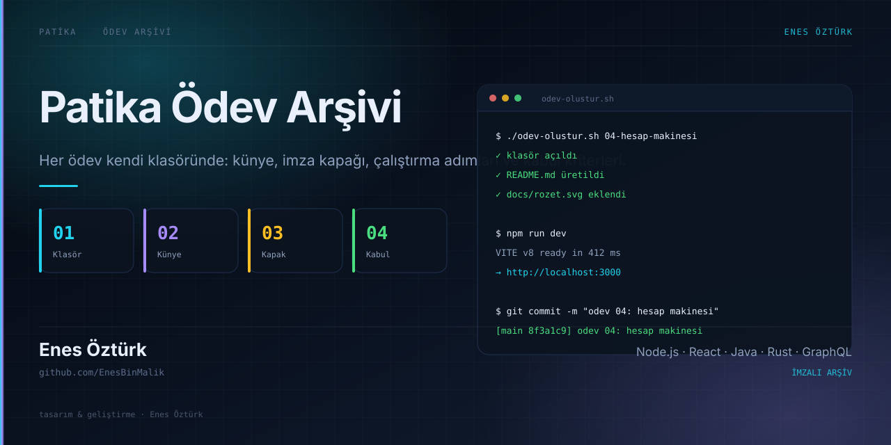
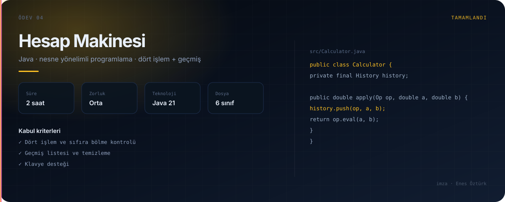
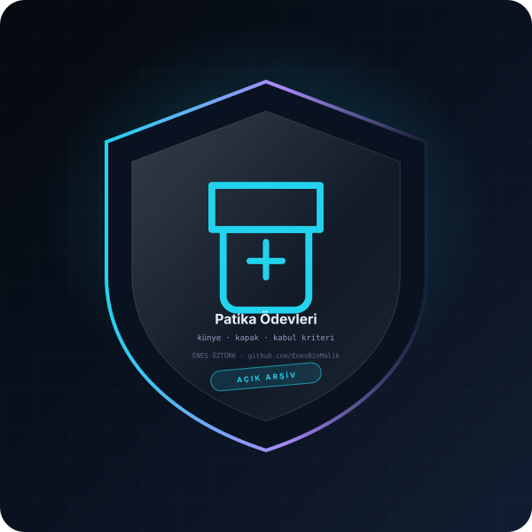

# Patika Ödev Arşivi



> **Patika.dev müfredatından ödevler, tek düzen altında** — hazırlayan: **Enes Öztürk**

[](#-ödev-dizini)
[](#-ödev-düzeni)
[](LICENSE)
[](https://github.com/EnesBinMalik)

---

## Bu depo nedir?

Patika.dev patikalarında çözdüğüm ödevlerin **tek düzen altında** toplandığı arşiv. Her ödev kendi
klasöründe durur ve dört şeyi eksiksiz taşır: künye (README), imza kapağı, çalıştırma adımları ve kabul
kriterleri. Amaç; ödevi okuyan kişinin ne yapıldığını, nasıl çalıştırılacağını ve neyin doğru kabul
edildiğini tek bakışta görmesi.

| Özellik | Nasıl |
|---|---|
| **Tek düzen** | Her klasör aynı README iskeletini ve aynı kapak oranını (1280×640) kullanır |
| **Ölçülebilir kabul** | Her ödevde "kabul kriterleri" listesi var; neyin bitmiş sayıldığı yazılı |
| **Çalıştırılabilir** | Her ödevde kopyalanabilir kurulum/çalıştırma komutları |
| **İzlenebilir** | `CHANGELOG.md` her ödevin hangi tarihte eklendiğini tutar |

<p align="center">
  
</p>

## Ödev dizini

| # | Ödev | Patika | Konu | Durum |
|:-:|---|---|---|:-:|
| 03 | [Hesap Makinesi](javascript-odevleri/03-hesap-makinesi) | JavaScript | Fonksiyonlar, olay dinleme, durum | ✅ |

> Yeni ödev eklenince bu tabloya bir satır eklenir. Durum: ✅ tamam · 🚧 devam ediyor · 📝 planlı

## Ödev düzeni

```
<patika-adi>/<odev-no>-<odev-adi>/
├── README.md          # künye: konu, kazanımlar, kurulum, kabul kriterleri
├── docs/
│   ├── rozet.svg      # ödevin imza rozeti (form + simge ödeve göre)
│   └── ekran.svg      # arayüz/konsol görünümü
├── src/               # ödev kaynakları
└── package.json       # (varsa) bağımlılıklar ve komutlar
```

### README iskeleti

Her ödev README'si şu başlıklarla açılır — kopyalayıp doldurmak için
[`sablon/README-sablon.md`](sablon/README-sablon.md) dosyasını kullan:

1. **Başlık + rozet** — ödev adı ve tek satırlık tanım
2. **Konu ve kazanımlar** — bu ödev hangi konuyu kapatıyor, ne öğrendim
3. **Kurulum ve çalıştırma** — kopyalanabilir komutlar
4. **Kabul kriterleri** — işaretlenebilir kontrol listesi
5. **Notlar** — karşılaşılan hatalar ve çözümleri

## Ödev ekleme

Yeni bir ödev eklerken üç adım:

```bash
# 1) klasörü ve iskeleti oluştur
mkdir -p "javascript/05-hesap-makinesi"/{docs,src}
cp sablon/README-sablon.md "javascript/05-hesap-makinesi/README.md"

# 2) kapağı üret (imza dili otomatik)
python tools/kapak.py "javascript/05-hesap-makinesi"

# 3) kök README'deki ödev dizinine satır ekle ve commit et
git add . && git commit -m "odev 05: hesap makinesi"
```

## Katkı

Bu depo kişisel bir arşiv; ödevler tek tek benim çözümlerim. Hata bildirimi, düzeltme önerisi ve sorular
için **issue** açabilirsin. Katkı kuralları: [`CONTRIBUTING.md`](CONTRIBUTING.md) ·
Davranış kuralları: [`CODE_OF_CONDUCT.md`](CODE_OF_CONDUCT.md)

## Lisans

[MIT](LICENSE) — kodu kendi ödevinde kullanabilirsin; kopyalayıp teslim etmek yerine okuyup kendin
yazmanı öneririm.

<div align="center">



<sub><b>Enes Öztürk</b> · github.com/EnesBinMalik · tasarım ve geliştirme bana ait</sub>

</div>
