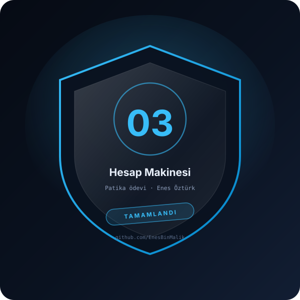

# ÖDEV <no> — <ödev adı>



> **Patika · <patika adı> · <konu>** — çözen: **Enes Öztürk**

**Tek satır tanım:** bu ödev ne yapıyor.

---

## Konu ve kazanımlar

- **Konu:** hangi konuyu kapatıyor (örn. döngüler, diziler, sınıflar)
- **Kazanımlar:**
  - [ ] kazanım 1
  - [ ] kazanım 2
  - [ ] kazanım 3

## Kurulum ve çalıştırma

```bash
# bağımlılık varsa
npm install
npm run dev        # http://localhost:3000
```

| Komut | Not |
| --- | --- |
| `npm install` | bağımlılıklar |
| `npm run dev` | geliştirme sunucusu |
| `npm run build` | üretim derlemesi |

## Kabul kriterleri

- [ ] Ana akış çalışıyor ve hata vermiyor
- [ ] Girdi doğrulaması var (boş, hatalı, sınır değer)
- [ ] Kod okunabilir: anlamlı isimler, tek sorumluluk
- [ ] README güncel: kurulum adımları kopyalanabilir

## Notlar

- Karşılaşılan hata: … → çözüm: …

## Lisans

[MIT](../LICENSE) · bu ödev **Enes Öztürk** tarafından çözülmüştür.
